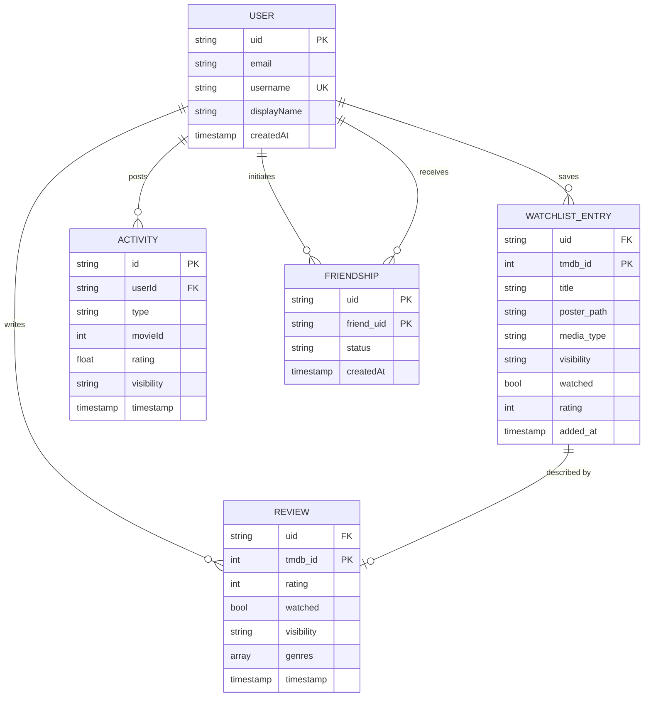

# Entity Relationship Diagram

## Firestore mapping

- `users/{uid}` — the `USER` entity. `email` and `username` are lowercased.
- `usernames/{username}` — reservation documents that enforce unique usernames.
- `users/{uid}/watchlist/{tmdbId}` — the `WATCHLIST_ENTRY` entity, now with `visibility`, `watched`, and `rating`.
- `users/{uid}/reviews/{tmdbId}` — the `REVIEW` entity, including a TMDB genre snapshot (`[{id, name}]`) used by the monthly recap.
- `friendships/{sortedUidA_uidB}` — the `FRIENDSHIP` entity. `uid` is the sender (`userId`), `friend_uid` is the recipient (`friendId`), and `status` is `pending` or `accepted`. The document ID is the two UIDs sorted and joined with `_`; a `participants` array mirrors both UIDs for single-query lookups.
- `activity/{id}` — the `ACTIVITY` entity. `type` is `rated` or `watched`, and `visibility` is `public` or `private`.

## Access rules summary

Users may read profiles, but only write their own. Watchlist entries and reviews are owner-only. A friendship may be created only as `pending` by the sender, accepted only by the recipient, and deleted by either participant. Activity is owner-writable and readable by others only when it is `public` and the requesting user has an accepted friendship with its author.
