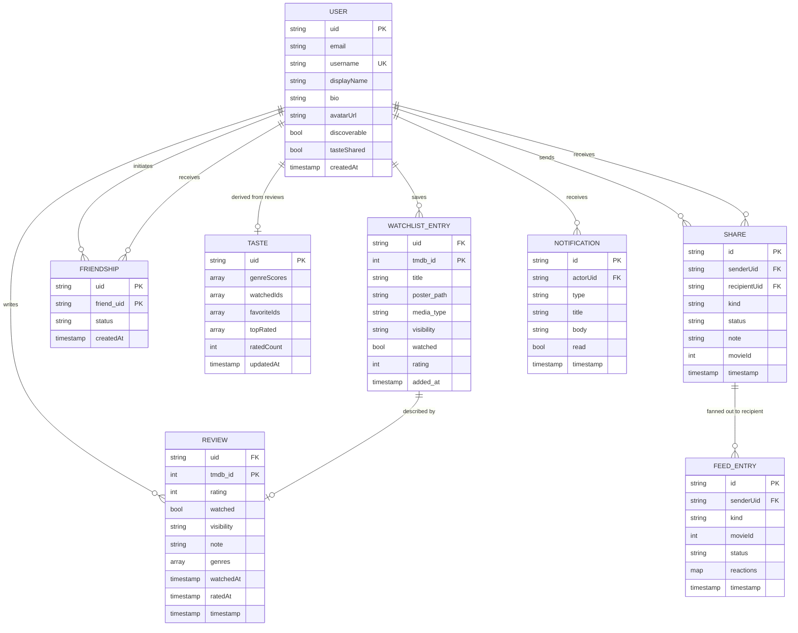

# Entity Relationship Diagram

## Firestore mapping

- `users/{uid}` — the `USER` entity. `email` and `username` are lowercased. Profiles include bio, avatar URL, discoverability, and taste-sharing flags.
- `usernames/{username}` — reservation documents that enforce unique usernames. Reads require a signed-in user.
- `users/{uid}/watchlist/{tmdbId}` — the `WATCHLIST_ENTRY` entity. Owned entries merge on re-add and never overwrite `added_at`, `watched`, `visibility`, or `rating`.
- `users/{uid}/reviews/{tmdbId}` — the `REVIEW` entity. `watchedAt` and `ratedAt` are stable timestamps; `timestamp` is only a legacy fallback and update marker.
- `taste/{uid}` — derived recommendation/compatibility data recomputed from the owner's reviews. Readable by signed-in users when `tasteShared` is true.
- `friendships/{sortedUidA_uidB}` — the `FRIENDSHIP` entity. `userId` is the sender, `friendId` is the recipient, and `status` is `pending` or `accepted`. `participants` mirrors both UIDs.
- `shares/{shareId}` — explicit movie sends and watch-night invites. `kind` is `movie` or `watch_together`; `status` is `sent`, `accepted`, or `declined`.
- `users/{uid}/feed/{shareId}` — fan-out feed entries written only for the recipient. No public auto-publish.
- `users/{uid}/notifications/{notificationId}` — share, invite, and reply notifications.

## Access rules summary

Users may read profiles while signed in, but only write their own. Watchlist entries and reviews are owner-only. A friendship may be created only as `pending` by the sender, accepted only by the recipient, and deleted by either participant. Shares are readable and writable only by participants and require an accepted friendship at creation. Feed and notification documents are written by the sender but read by the recipient. Taste documents are owner-written and readable when taste sharing is enabled.
